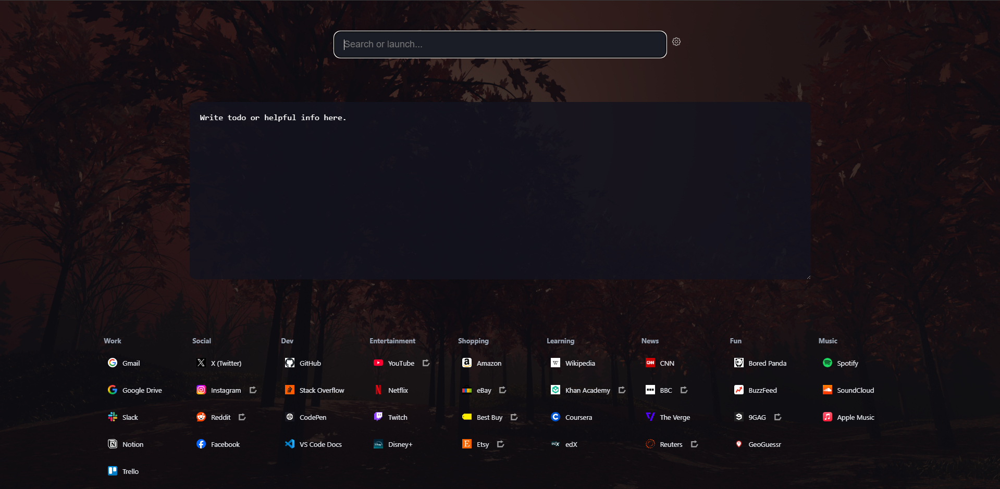

# PHomePage
My own personal homepage designed to be simple, easy to setup, and reliable while also having support for customization.

Designed to be simple to setup anywhere without a background program or local server. A simple html file to set as a homepage with a custom protocol to give the page the ability to sync between devices run programs from your pc and more.



# Features
- Customize which photos appear in the background.
- Create categories of bookmark links with shortcuts.
- A smart search bar capable of most things you would expect from chromes search bar as well as support for adding more features.
- Syncs information across devices.

# How to setup

- Download this repo and place it anywhere.
- [Install this](https://chromewebstore.google.com/detail/custom-new-tab-url/mmjbdbjnoablegbkcklggeknkfcjkjia) or any other custom new tab page extension to set it as your home page.
- Set the location of index.html on your device as the homepage.
- Make sure to allow the extension access to file urls in your browsers extension config.

# Enabling Extra Features
To enable syncing and other features like syncing, and application shortcuts
Run the setup command in the main directory. This will setup the phome protocol the website can use.
```
python setup.py
```